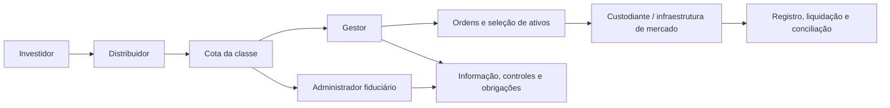

# Mercados, instrumentos e participantes

## Sistema financeiro e mercado de capitais

O mercado financeiro conecta agentes com excedente de poupança a agentes que demandam recursos. O mercado monetário administra liquidez de curtíssimo prazo; o de crédito intermedeia empréstimos; o cambial troca moedas; e o de capitais financia empresas e projetos por instrumentos como ações, debêntures e cotas de fundos. Mercado primário financia o emissor; secundário permite negociação entre investidores e fornece preço e liquidez.

A CVM regula e fiscaliza o mercado de valores mobiliários; o Banco Central atua sobre instituições financeiras, política monetária e sistemas de pagamento; o CMN estabelece diretrizes. B3 opera infraestrutura de negociação, registro, compensação, liquidação e depósito centralizado em segmentos autorizados. Autorregulação e regras de infraestrutura complementam, sem substituir, a lei e a regulação.

## Intermediários e prestadores de fundos

- **Administrador fiduciário:** constitui e administra o fundo, mantém controles, escrituração e obrigações regulatórias, contrata serviços e assegura a operação conforme regulamento e normas. Não escolhe necessariamente cada ativo.
- **Gestor:** toma decisões de investimento e desinvestimento dentro da política, limites e dever fiduciário; executa ou encaminha ordens e acompanha risco e carteira.
- **Custodiante:** guarda e controla ativos, concilia posições e liquida operações conforme contratação e regra aplicável. Ativos escriturais podem ter depositário central.
- **Distribuidor:** aproxima o produto do investidor, conduz distribuição, coleta informações cadastrais e de perfil, verifica adequação quando exigida e presta informações da oferta.
- **Escriturador:** mantém registros de titularidade e eventos de valores mobiliários escriturais.
- **Auditor independente:** opina sobre demonstrações contábeis, com independência e escopo definido.
- **Agência de rating:** expressa opinião sobre risco de crédito segundo metodologia; não garante pagamento nem substitui análise própria.

A Resolução CVM 175 separa prestadores essenciais — administrador e gestor — e define responsabilidades próprias e compartilhadas. Terceirizar atividade não elimina os deveres regulatórios do prestador responsável. Leia Parte Geral, capítulo de prestação de serviços e anexo específico do fundo.

## Produtos e retorno

Título de dívida promete pagamentos contratuais sujeitos ao risco do emissor. Ação representa participação residual. Derivativo transfere exposição a preço, taxa, moeda, índice ou crédito. Fundo reúne recursos em condomínio especial, com classes e subclasses conforme regra e regulamento. Uma cota é participação no patrimônio da classe, não propriedade direta proporcional de cada ativo.

Retorno nominal não é retorno real. Com inflação \(\pi\), retorno real exato é:

$$r_{real}=\frac{1+r_{nominal}}{1+\pi}-1.$$

## Benchmark e mandato

Benchmark é referência de comparação compatível com objetivo e risco: CDI para certas estratégias pós-fixadas; índice de inflação mais spread para mandato real; índice de ações para carteira acionária. Aderência ao benchmark não significa garantia de retorno. **Tracking error** é o desvio-padrão da diferença entre retorno da carteira e benchmark. Uma referência inadequada incentiva risco incompatível.

## Fluxo da indústria de fundos

## Entenda a cadeia do dinheiro com um exemplo

Suponha que uma empresa queira construir uma usina e precise de R$ 500 milhões. Ela pode tomar empréstimos, emitir debêntures ou receber capital de sócios. Se emitir uma debênture, a empresa é a **emissora** e assume uma obrigação. O investidor compra o título e passa a ter um direito de receber pagamentos definidos. Uma instituição pode coordenar a oferta; distribuidores apresentam a oportunidade a investidores; sistemas de mercado registram e liquidam a operação; custodiantes e escrituradores prestam serviços de controle; reguladores estabelecem regras de conduta e divulgação.

A sequência não é apenas burocracia. Cada agente protege uma parte do processo. O investidor precisa saber o que está comprando e quais são os riscos; a empresa precisa cumprir as condições da emissão; os intermediários precisam executar as atividades para as quais estão autorizados; e o mercado precisa de registros que permitam saber quem tem o quê e quais pagamentos ocorreram.

## Uma operação percorre quatro momentos

1. **Estruturação:** emissor e assessores definem instrumento, valor, prazo, remuneração, garantias e condições.
2. **Oferta primária:** os títulos são oferecidos a investidores. A empresa recebe os recursos líquidos captados, descontadas as despesas da operação.
3. **Registro e liquidação:** as instruções são confirmadas; o dinheiro e o ativo são entregues segundo prazos e sistemas aplicáveis.
4. **Vida do ativo e mercado secundário:** a empresa paga juros/principal e divulga informações; investidores podem negociar o título entre si. O preço secundário muda com taxa, crédito e liquidez.

A negociação secundária pode dar ao investidor uma saída antes do vencimento, mas não promete que haverá comprador ao preço desejado. Liquidez é uma característica observável e variável, não uma cláusula de garantia.

## As funções dos prestadores de fundos em detalhe

**Gestão** responde à pergunta “em que investir?”. O gestor interpreta o mandato e decide comprar, manter, reduzir ou vender ativos. Precisa observar limites, liquidez, concentração, riscos, interesses dos cotistas e procedimentos de decisão. O gestor não altera sozinho o mandato só porque uma oportunidade parece atraente.

**Administração fiduciária** responde, de modo simplificado, “como o fundo é organizado e cumpre suas obrigações?”. O administrador cuida de funções como constituição e funcionamento, controles, documentos, informes e contratação de serviços, conforme a regulação e o contrato. Ele não é necessariamente quem decide cada investimento.

**Custódia** trata de serviços de guarda, controle, conciliação ou liquidação contratados para os ativos. Custodiar não significa garantir a qualidade econômica do ativo. Se um emissor não paga uma debênture, a custódia correta não transforma o crédito em pagamento certo.

**Distribuição** é a atividade de apresentar e distribuir o produto. No contato com o investidor entram informação, cadastro, identificação de público-alvo e adequação ao perfil, segundo as regras. O distribuidor não pode eliminar riscos com uma explicação otimista.

**Escrituração** mantém registros de titulares e eventos quando aplicável. **Auditoria independente** examina demonstrações contábeis em escopo próprio. **Agência de rating** publica opinião metodológica sobre crédito. Nenhuma dessas funções substitui as demais.

## Por que separar papéis e controlar conflitos?

Uma instituição pode prestar mais de um serviço, e certas estruturas envolvem partes relacionadas. O problema não é automaticamente haver várias funções na mesma casa; o risco é uma decisão favorecer a instituição ou um cliente em detrimento do fundo sem controle adequado. Exemplos: escolher ativo de empresa do grupo, distribuir ativo escasso primeiro ao fundo mais rentável, contratar empresa ligada por preço inadequado, ou divulgar desempenho sem explicar risco.

Controles úteis incluem segregação de informação, aprovação independente, critérios de rateio definidos previamente, comparação de preço, registro da decisão, divulgação de conflito quando requerida e monitoramento depois da operação. Para estudar o caso, pergunte: quem decide, quem se beneficia, quem fiscaliza e que evidência demonstra tratamento justo?

## Primário versus secundário: mini exemplo

Uma debênture de R$ 1.000 é emitida pela Companhia X. Na emissão, a investidora Ana compra por R$ 1.000; o dinheiro vai para a Companhia X. Se seis meses depois Ana vende o título a Bruno por R$ 970, Bruno paga Ana, não a empresa. A queda para R$ 970 pode refletir mudança de juros, risco percebido ou liquidez. A obrigação da empresa segue os documentos do título, embora o preço de negociação tenha mudado.

## O que o regulador e a infraestrutura fazem

A CVM regula o mercado de valores mobiliários dentro de sua competência, incluindo participantes, fundos e ofertas. O Banco Central e o Conselho Monetário Nacional têm atribuições diferentes relacionadas ao sistema financeiro e à política monetária. A B3 opera ambientes e serviços de mercado; ela não decide se um investimento é adequado para toda pessoa. A autorregulação pode detalhar padrões para participantes vinculados, mas não substitui lei ou regulação pública.

Ao ler uma operação, não use “a B3 aprovou”, “o banco oferece” ou “tem rating” como substituto da pergunta principal: quais direitos tenho, quem deve pagar, que risco corro e em quais documentos isso está escrito?
