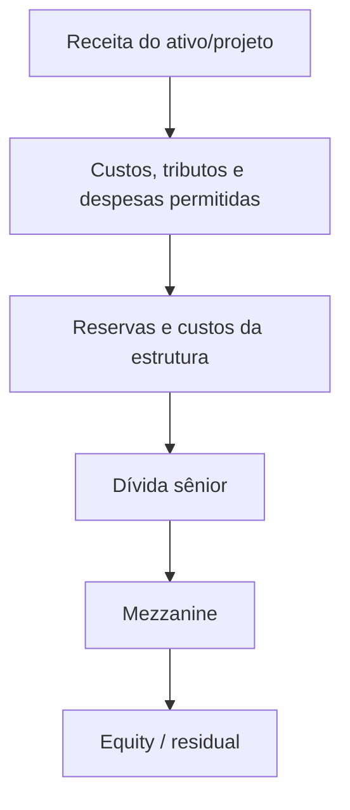

# Finanças corporativas e análise de projetos

## Da operação ao valor do negócio

Finanças corporativas pergunta como a empresa investe, financia e devolve capital. A análise conecta uma decisão operacional (construir, comprar, expandir, manter) a fluxos de caixa, risco e custo de oportunidade. Contabilidade fornece base; o valuation exige estimar caixa futuro e taxa compatível, explicitando incerteza.

## Demonstrações e métricas

- **CAPEX:** investimento em ativos de longa duração; consome caixa hoje e pode ser depreciado/amortizado ao longo do tempo.

- **OPEX:** despesas necessárias à operação cotidiana, como pessoal, manutenção e serviços. Classificação contábil depende da natureza e das normas aplicáveis; empurrar manutenção necessária para o futuro pode inflar temporariamente métricas.
- **EBITDA:** aproximação do resultado operacional antes de juros, impostos, depreciação e amortização. Não inclui CAPEX nem capital de giro, então não deve ser tratado como caixa disponível para pagar dívida ou distribuir.
- **FCFF:** fluxo de caixa livre para todos os provedores de capital, antes dos pagamentos a credores e acionistas. Uma fórmula didática é $FCFF=EBIT(1-T)+D\&A-CAPEX-\Delta CG$, com ajustes conforme o caso.
- **WACC:** custo médio ponderado das fontes de financiamento, com pesos de mercado e custo da dívida após o benefício fiscal quando aplicável: $WACC=E/(D+E)k_e+D/(D+E)k_d(1-T)$. Só é taxa de desconto adequada quando o risco dos fluxos e a estrutura financeira são compatíveis com as hipóteses.

### Exemplo de FCFF

Considere EBIT de R$ 100 milhões, alíquota efetiva de 30%, depreciação de R$ 20 milhões, CAPEX de R$ 35 milhões e aumento de capital de giro de R$ 10 milhões. O FCFF simplificado é $100(1-0{,}30)+20-35-10=R\$45$ milhões. O lucro operacional após imposto é R$ 70 milhões; a depreciação é adicionada porque reduziu lucro sem saída de caixa no período; CAPEX e capital de giro são subtraídos porque consomem caixa.

Se WACC for 12%, o valor da empresa pode ser estimado descontando FCFF futuro a essa taxa. Isso só é coerente se os fluxos forem livres para todos os financiadores, moeda e inflação forem compatíveis e o risco estiver refletido de modo consistente. Descontar FCFF pelo custo do equity ou descontar fluxo ao acionista pelo WACC mistura conceitos.

### VPL e TIR na decisão de investir

VPL responde “quanto valor, em dinheiro de hoje, sobra depois de remunerar o capital à taxa exigida?”. TIR responde “qual taxa zera esse saldo?”. Imagine investimento inicial de R$ 10 milhões e entradas líquidas de R$ 4 milhões por três anos. Calcule $VPL=-10+4/(1+k)+4/(1+k)^2+4/(1+k)^3$. Com custo de capital de 10%, o VPL é positivo; se os recebimentos atrasarem ou custo subir, ele diminui. Sensibilidade e cenários devem acompanhar o valor pontual.

Projetos mutuamente excludentes podem produzir resultados conflitantes: o projeto pequeno pode ter TIR maior, mas criar menos valor total; outro pode gerar mais VPL com retorno percentual menor. Considere restrição de capital, capacidade, risco e complementaridade, não apenas o ranking por TIR.

## Dívida, capacidade de pagamento e proteção

Alavancagem pode ampliar retorno do acionista enquanto o negócio cresce, mas torna a estrutura mais vulnerável a queda de receita e aumento do custo financeiro. Compare dívida bruta e líquida, caixa disponível, perfil de vencimento, indexador, moeda, garantias e covenants. EBITDA/dívida líquida é uma razão operacional aproximada: seu significado depende de estabilidade do EBITDA e de caixa realmente acessível.

**DSCR** (Debt Service Coverage Ratio) compara caixa disponível para serviço da dívida com juros e principal do período: $DSCR=CFADS/Serviço\ da\ dívida$. CFADS é caixa disponível para serviço da dívida depois de despesas operacionais, impostos, capital de giro e reservas definidas pela estrutura. Se CFADS é R$ 120 milhões e serviço da dívida R$ 100 milhões, DSCR = 1,2x, uma folga de 20%. Não é margem de lucro nem mede sozinho risco futuro; teste queda de receita, aumento de custos e atraso de recebíveis.

Covenants são compromissos contratuais financeiros ou não financeiros. Podem limitar endividamento, distribuição, venda de ativos ou mudança de controle e exigir índices mínimos. Violação pode gerar renegociação, vencimento antecipado ou outras consequências contratuais, conforme documento. Avalie definição exata do indicador, frequência de teste, cura, waivers concedidos e espaço até o limite.

## Estrutura de capital e custo do capital

Capital próprio assume risco residual e normalmente exige retorno maior; dívida tem prioridade contratual, mas exige pagamentos definidos e pode elevar risco de insolvência. O WACC depende de pesos, custo de cada fonte, tributos e risco operacional/financeiro. Não se deve reduzir o WACC apenas por aumentar dívida: alavancagem eleva risco do equity e pode elevar o custo da dívida.

Para negócios de infraestrutura, diferencie risco de construção, operação, demanda, contraparte, regulação, licenciamento e refinanciamento. Contratos e garantias redistribuem esses riscos; raramente os eliminam. Modelos devem incluir cronograma físico-financeiro, atraso, contingência de CAPEX, curva de ramp-up, manutenção e cenário de estresse.
- **OPEX:** custos operacionais recorrentes reconhecidos no período conforme competência.
- **EBITDA:** lucro antes de juros, tributos, depreciação e amortização; aproxima geração operacional, mas não é fluxo de caixa: omite CAPEX, capital de giro, impostos e serviço da dívida.
- **FCFF:** fluxo livre para todos os financiadores, após custos, tributos operacionais, CAPEX e variação de capital de giro, antes de serviço da dívida.

$$FCFF=EBIT(1-T)+D+A-CAPEX-\Delta NWC.$$

**FCFE** é fluxo ao acionista depois de dívida líquida e juros, com convenções consistentes. Não desconte FCFE pelo WACC: use custo do equity. Não desconte FCFF pelo custo do equity: use WACC.

## WACC e estrutura de capital

$$WACC=\frac{E}{D+E}K_e+\frac{D}{D+E}K_d(1-T).$$

E e D devem refletir valores de mercado/estrutura-alvo quando apropriado; \(K_e\) e \(K_d\) têm mesma moeda, prazo e base nominal/real que os fluxos. Benefício fiscal dos juros só cabe se houver capacidade de aproveitá-lo e regra tributária aplicável. Custo do equity pode ser estimado via CAPM: \(K_e=R_f+\beta(E[R_m]-R_f)\), com limitações em mercados emergentes e ativos não listados.

## Retorno de projetos e crédito

TIR/IRR é taxa que zera VPL; VPL/NPV desconta todos fluxos ao custo de oportunidade. Para crédito estruturado:

$$DSCR=\frac{CFADS}{Serviço\ da\ dívida}.$$

CFADS é caixa disponível para serviço da dívida, usualmente após custos operacionais, tributos e CAPEX de manutenção, conforme documentos da operação. DSCR < 1 significa insuficiência no período sob aquela definição. Projete caso-base, downside e severo; teste sazonalidade, atraso de obra, custo e taxa.

**Covenants** são cláusulas de proteção (financeiras e não financeiras): limites de alavancagem, DSCR mínimo, restrição a dividendos ou obrigações de reporte. Gatilho não é default automaticamente: leia cura, waiver e remédios contratuais. **Rating** é opinião de crédito, sujeita a metodologia, informação e conflito; não é garantia.

## Capital stack e waterfall

- **Dívida sênior:** prioridade de pagamento e, em geral, menor risco/retorno esperado.
- **Mezzanine:** prioridade abaixo do sênior, remuneração maior e possíveis mecanismos híbridos.
- **Equity:** residual após obrigações prioritárias, maior risco e potencial de valorização.
- **Tranche:** classe de risco/pagamento com regras próprias em estrutura de securitização ou financiamento.

Subordinação distribui perdas segundo waterfall, mas não remove risco do ativo. Modelar waterfall por período e cenários, incluindo despesas, reservas, pagamentos, amortização e gatilhos.

