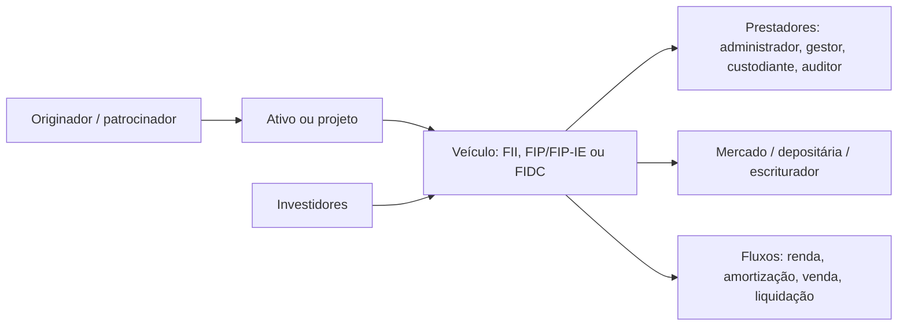

# Fundos estruturados e desenho da transação

## Pense primeiro no ativo e no fluxo de dinheiro

Um fundo estruturado é um veículo coletivo com regras para reunir recursos e investir em ativos que exigem análise especializada, governança e horizonte próprios. Não comece pelo nome do produto. Comece perguntando: qual ativo será comprado, como ele gera caixa, quem paga, em que datas, o que pode impedir o pagamento, quem monitora e como o investidor pode sair?

## Arquitetura de veículo

Comece pela necessidade econômica, ativo, horizonte, fluxo de caixa, investidores e saída. Só então selecione veículo e classe. Defina partes, governança, política, elegibilidade, subscrição, integralização, avaliação, custódia, auditoria, distribuição, eventos de inadimplemento, saída e liquidação.

Desenhe a estrutura como uma cadeia. Investidores comprometem ou integralizam capital; o fundo adquire ativos; devedores, locatários ou empresas investidas geram caixa; prestadores verificam, administram, custodiam e reportam; o fundo paga despesas, juros, amortizações e distribuições segundo regras. Se qualquer elo falha, a rentabilidade prevista pode não se materializar.

## Partes, responsabilidade e conflitos

O administrador fiduciário responde por funções de constituição, funcionamento e controles do fundo conforme a regulamentação e o regulamento. O gestor toma decisões de investimento dentro do mandato e acompanha os ativos conforme suas atribuições. Custodiante guarda ativos financeiros e/ou controla sua movimentação nos termos aplicáveis. Distribuidor oferece cotas aos investidores e conduz procedimentos de distribuição e relacionamento que lhe cabem. Auditor independente examina demonstrações; agente de rating emite opinião sobre risco de crédito quando contratado. A divisão exata depende da categoria, da norma vigente e dos contratos; nomes parecidos não significam deveres idênticos.

Mapeie conflitos: prestador ligado ao originador, avaliação feita por parte interessada, remuneração atrelada a captação ou transação, operações entre partes relacionadas, seleção de ativos próprios e distribuição de produto inadequado. Mitigue com divulgação, segregação, política, aprovação independente, documentação e monitoramento. “Todos os prestadores regulados” não elimina conflito econômico.

## Fluxo de caixa e cascata de pagamentos

Em uma estrutura com tranches, o caixa disponível é distribuído por uma **waterfall** definida em documentos. Uma ordem didática possível é: tributos e despesas essenciais; custos e reservas; juros e principal da classe sênior; pagamentos de classes subordinadas; residual para equity. A ordem real depende dos documentos e pode incluir regras específicas, testes, amortização antecipada e eventos de gatilho.

Considere R$ 10 milhões disponíveis depois de custos. A tranche sênior tem R$ 7 milhões a receber e a subordinada R$ 2 milhões. Se a prioridade sênior for cumprida primeiro, sobram R$ 3 milhões para a subordinada até seu limite; o residual depende da regra da estrutura. Em um cenário de apenas R$ 6 milhões de caixa, a sênior pode não receber tudo e subordinadas não recebem, dependendo das proteções e garantias. Subordinação redistribui perda e prioridade; não cria caixa adicional nem torna o ativo subjacente melhor.

## Documentos e pontos de diligência

Leia regulamento, anexos de classe, lâmina/material de oferta, contratos, política de investimento, critérios de avaliação e relatórios. Extraia em linguagem simples: elegibilidade, concentração, prazo, amortização, resgate, voto, assembleia, taxa, despesas, conflitos, fatos que alteram direitos e hipóteses de liquidação. Verifique coerência entre material comercial e documentos vinculantes.

Na diligência econômica, faça reconciliação entre ativo, contrato e caixa recebido. Na jurídica, confirme titularidade, cessão, garantias, prioridade e exequibilidade. Na operacional, examine dados, conciliação, controles e continuidade de prestadores. Na financeira, modele base, estresse e liquidação. O risco do veículo inclui riscos do ativo e da própria estrutura.

## Como comparar veículos

FII concentra exposição imobiliária e pode combinar imóvel físico e valores mobiliários elegíveis. FIP adquire participações e depende de governança ativa e saídas de longo prazo. FIDC compra direitos creditórios e precisa provar origem, existência, elegibilidade, cobrança e prioridade. FI-Infra investe sob requisitos legais e regulatórios específicos; o ativo pode envolver projeto, concessão e risco de crédito. A escolha do veículo muda governança, liquidez, avaliação e obrigações, e não remove o risco econômico.

As regras de fundos são atualizadas. Para qualquer operação concreta, confirme versão consolidada da Resolução CVM 175, anexos e normas complementares, além dos documentos da classe e da oferta. Este tutorial explica a lógica econômica e não substitui validação jurídica ou tributária atual.

## Risco-retorno por camada

Investidores sênior têm prioridade contratual; subordinados absorvem perdas primeiro em certas estruturas. Regras de teste de subordinação, excesso de spread, reserva, amortização sequencial e eventos de avaliação antecipada devem ser modeladas com prioridade e temporalidade exatas. Proteção não é garantia; risco de correlação, servicer, fraude, concentração ou falha operacional pode atravessar camadas.

## Underwriting e valuation

Monte modelo por ativo: premissas operacionais, cronograma, receitas, despesas, CAPEX, impostos, capital de giro, dívida e caixa distribuível. Recalcule caso-base e cenários. Faça diligência legal, técnica, financeira, ambiental, tributária, operacional e de integridade. Registre fontes dos dados e riscos não quantificáveis.

Indicadores: VPL/NPV, TIR/IRR, múltiplos, yield on cost, cap rate, DSCR, LTV, vacância, inadimplência, pré-pagamento, prazo médio e recuperação. Nenhuma métrica isolada substitui análise do fluxo, qualidade do ativo e governança.

## Governança e conflito

Mapeie partes relacionadas, fee stacking, avaliação independente, alocação entre veículos, serviços do originador/gestor, voto e conflitos de saída. Defina informação periódica e material, evento de crédito, política de avaliação e processo de remediação. Cota de fundo é valor mobiliário sujeito ao regime aplicável mesmo quando representada digitalmente.
