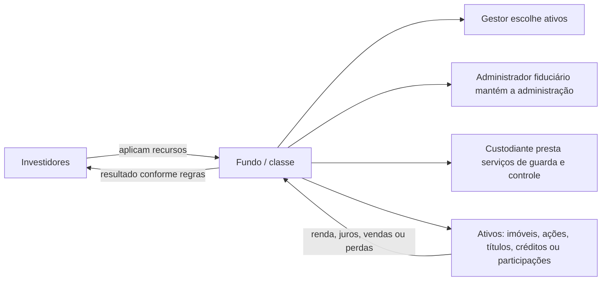

# 4. Fundos, papéis e estruturas de investimento

## 4.1 Como um fundo organiza o investimento

Um fundo reúne investidores, emite cotas e compra ativos. O regulamento explica objetivo, estratégia, riscos, custos, prazos e direitos. A carteira pertence ao patrimônio da classe do fundo conforme a estrutura legal; o cotista tem cotas, não a propriedade direta de uma fração de cada imóvel ou crédito.

Os participantes prestam serviços diferentes. Os deveres detalhados dependem das normas, dos contratos e da categoria do fundo.

## 4.2 FII: imóveis e renda imobiliária

**FII** significa Fundo de Investimento Imobiliário. Dependendo da política e das regras aplicáveis, pode investir em imóveis, direitos imobiliários ou ativos ligados ao setor, como determinados títulos e cotas de outros fundos.

Um fundo de imóveis alugados pode receber aluguéis e pagar despesas do imóvel. Um fundo que compra recebíveis imobiliários se expõe a pagamentos de devedores e às garantias dos créditos. Muitos fundos combinam estratégias.

Termos comuns:

- **Vacância:** parte do imóvel que está desocupada.
- **NOI:** renda operacional líquida do imóvel, conforme uma definição de cálculo.
- **Cap rate:** medida que compara renda de imóvel e valor estimado.
- **P/VP:** comparação do preço da cota com o valor patrimonial por cota.
- **Distribuição:** valor que o fundo paga aos cotistas conforme regras e resultados; não é promessa de renda futura.

Riscos comuns incluem vacância, inadimplência de locatário/devedor, despesas e obras, juros, concentração e baixa liquidez da cota.

## 4.3 FIP: participação em empresas

**FIP** significa Fundo de Investimento em Participações. Ele pode investir em empresas e participações elegíveis segundo as normas e o regulamento. O objetivo pode ser ajudar a empresa a crescer ou reorganizar operações e, no futuro, vender a participação ou obter outra forma de saída.

Como empresas não listadas podem não ter um preço observado diariamente, o valor estimado da participação depende de avaliações e premissas. A saída pode demorar anos. **MOIC** resume quanto se recebeu em relação ao capital investido; **TIR** também considera quando cada aporte e recebimento aconteceu.

Termos de remuneração de gestores podem incluir **hurdle** (retorno mínimo previsto), **carry** (parcela variável de resultados) e outros ajustes contratuais. Não assuma que todos os FIPs usam a mesma estrutura.

## 4.4 FIP-IE: participações em projetos de infraestrutura

**FIP-IE** é uma modalidade de FIP voltada a projetos de infraestrutura que atendam aos requisitos legais. O projeto pode envolver energia, transporte, saneamento ou outras áreas elegíveis. Construir e operar infraestrutura leva tempo e pode envolver licença, obra, tarifa, concessão e risco regulatório.

Uma regra ou vantagem tributária nunca deve ser concluída só pelo nome do fundo. É preciso conferir lei vigente, elegibilidade do projeto e veículo, oferta, investidor, prazo e demais condições.

## 4.5 FIDC: direitos de receber pagamentos

**FIDC** significa Fundo de Investimento em Direitos Creditórios. Um direito creditório é a promessa ou direito de receber um pagamento: por exemplo, parcelas de uma venda a prazo, aluguel ou prestação de um empréstimo.

O FIDC pode comprar ou receber esses créditos conforme regras e documentos. O dinheiro pago pelos devedores é usado segundo uma sequência contratual. O gestor e os demais prestadores monitoram elegibilidade, documentação, cobrança e riscos de acordo com suas responsabilidades.

- **Originador:** empresa que criou/reuniu os créditos.
- **Lastro:** documentos e fatos que sustentam o direito de receber; precisa ser verificado.
- **Servicer:** prestador que cuida da cobrança ou administração dos pagamentos.
- **Subordinação:** ordem que pode fazer uma classe absorver perdas antes de outra.
- **Tranche:** camada de cotas com prioridade e exposição próprias.

Um arquivo guardado em blockchain ou um hash não prova sozinho que o crédito existe, que o devedor pagará ou que a cessão foi juridicamente válida.

## 4.6 Dívida sênior, mezzanine e equity

Imagine o dinheiro de um projeto entrando numa cascata (waterfall): primeiro podem ser pagas despesas e reservas; depois, a dívida sênior; depois, mezzanine; por fim, o equity recebe o que restar.

- **Sênior:** tem prioridade de pagamento conforme os documentos.
- **Mezzanine:** fica numa posição intermediária.
- **Equity:** recebe o residual depois das obrigações prioritárias e, em geral, absorve perdas antes.

Essa ordem pode proteger uma classe em certos cenários, mas não garante pagamento. Leia o contrato para saber exatamente a prioridade, as garantias, os gatilhos e o que acontece em caso de inadimplência.

## 4.7 FI-Infra e títulos de infraestrutura

**FI-Infra** é fundo financeiro com estratégia incentivada relacionada a infraestrutura, sujeito à Resolução CVM 175, à Lei 12.431/2011 e às demais regras aplicáveis. Pode ter exposição direta ou por meio de outros fundos. Acompanhe enquadramento e tributação na classe específica e confirme alterações vigentes.

Uma debênture de infraestrutura é uma dívida emitida por uma empresa/projeto. Investigue o emissor, os pagamentos, o projeto, as garantias, os covenants, a liquidez e os riscos de juros e crédito. O rótulo “infraestrutura” não elimina esses riscos.

## 4.8 Project finance: pagar a dívida com o projeto

Em **project finance**, a capacidade de o próprio projeto gerar caixa é central para pagar a dívida. Uma estrada, por exemplo, pode depender de tráfego, tarifa, disponibilidade, custos de operação, dívida e regras de concessão.

- **CAPEX:** dinheiro para construir ou melhorar o projeto.
- **OPEX:** gastos de operação e manutenção.
- **CFADS:** caixa disponível para o serviço da dívida segundo a documentação.
- **DSCR:** relação entre esse caixa e os pagamentos de dívida.
- **Covenants:** compromissos financeiros ou operacionais nos contratos.

Teste cenários: o que acontece se a obra atrasar, custar mais, o tráfego cair, houver revisão tarifária ou juros subirem?

## 4.9 Um roteiro para entender qualquer fundo

1. Qual ativo o fundo compra?
2. De onde vem o dinheiro que pode retornar ao cotista?
3. Quem deve pagar esse dinheiro?
4. Que perdas podem acontecer e em que ordem?
5. Qual é o prazo e como o cotista pode sair?
6. Quem decide, administra, registra, guarda e audita?
7. Quais custos e conflitos de interesse existem?
8. Qual norma, regulamento e oferta se aplicam?
