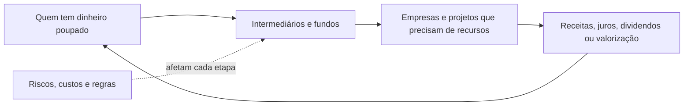

# Introdução ao mercado de investimentos

Este é o ponto de partida para quem ainda não trabalha no mercado financeiro. A ideia é traduzir o vocabulário que aparece nos materiais de **CFG**, **CGE** e **CGA** antes de exigir que você decore fórmulas ou regras.

## Comece por aqui

1. [Como o mercado de investimentos funciona](01-primeiros-passos.md) — quem poupa, quem precisa de recursos e como o investimento circula.
2. [Glossário essencial, em linguagem simples](02-glossario-essencial.md) — termos que aparecem ao longo dos três programas.
3. [Números, taxas e fórmulas sem medo](03-numeros-e-formulas.md) — como ler retorno, risco, preço e fluxo de caixa.
4. [Fundos, papéis e estruturas de investimento](04-fundos-e-estruturas.md) — participantes, FII, FIP, FIDC e FI-Infra.
5. [Tecnologia, tokenização e roteiro de estudos](05-tecnologia-e-roteiro.md) — ligação entre mercado tradicional e RWA digital.

## Como usar

Leia os capítulos nessa ordem. Quando encontrar um termo nos materiais de [CFG](../CFG/README.md), [CGE](../CGE/README.md) ou [CGA](../CGA/README.md), volte ao glossário. Depois, leia a explicação técnica no material da certificação. Esta introdução simplifica ideias para ensinar; regulamentos, contratos e normas podem dar significados mais específicos.

Os materiais de certificação foram escritos para aprofundar os conceitos depois deste primeiro contato. Não tente decorar tudo na primeira leitura: escreva com suas palavras o que cada indicador mede, refaça as contas e explique o efeito de uma mudança de premissa. Ao encontrar siglas, consulte o glossário e volte ao capítulo técnico para ver as ressalvas e o uso profissional.

## Um mapa mental

> Material educacional independente. Não é recomendação de investimento nem substitui edital, norma vigente, regulamento, contrato ou orientação profissional.
