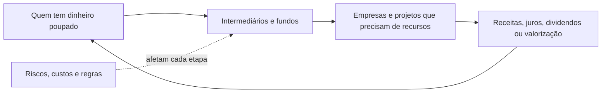

# Introdução ao mercado de investimentos

Este é o ponto de partida para quem ainda não trabalha no mercado financeiro. A ideia é traduzir o vocabulário que aparece nos materiais de **CFG**, **CGE** e **CGA** antes de exigir que você decore fórmulas ou regras.

## As certificações ANBIMA em um panorama

A ANBIMA oferece três certificações na trilha de gestão de recursos:

| Certificação | O que habilita | Pré-requisito | Prova |
|---|---|---|---|
| **CFG** | Fundamentos de gestão — porta de entrada | Nenhum | 60 questões, 3 h, aprovação ≥ 70% (42 acertos) |
| **CGA** | Gestão de fundos de renda fixa, ações, cambiais, multimercados e índices | CFG aprovada | 60 questões, 3 h 30 min, aprovação ≥ 70% |
| **CGE** | Gestão de fundos estruturados (FIDC, FII, FIP) | CFG aprovada | 60 questões, 3 h 30 min, aprovação ≥ 70% |

A **CFG** não é obrigatória para nenhuma função, mas é diferencial para quem quer trilhar carreira em gestão de recursos de terceiros. Todas têm validade de três anos e exigem atualização.

### Como funciona a prova CFG

- **60 questões** de múltipla escolha (4 alternativas cada).
- **3 horas** de duração (180 minutos).
- **Aprovação:** acertar ao menos **42 questões** (70%).
- **12 temas** com pesos diferentes — veja o [mapa completo](../CFG/Programa-e-mapa.md).
- Prova computadorizada, agendada em centros de teste autorizados.
- A legislação cobrada é aquela vigente até 6 meses antes da data do exame.

### Distribuição dos temas na prova

| Tema | Peso aproximado |
|---|---|
| Métodos quantitativos | 8–12% |
| Economia | 3–7% |
| Relatórios financeiros | 3–7% |
| Finanças corporativas | 3–7% |
| **Mercados e instrumentos financeiros** | **13–17%** |
| Teoria de carteiras e precificação | 8–12% |
| Finanças comportamentais | 3–7% |
| Política de investimento (IPS) | 3–7% |
| **Alocação de ativos** | **13–17%** |
| Novas tecnologias em finanças | 3–7% |
| Ética e autorregulação | 8–12% |
| Legislação e regulação | 8–12% |

> **Dica para quem está começando:** os temas em negrito têm maior peso. Mercados/instrumentos e alocação de ativos juntos representam até 34% da prova. Ética, autorregulação e legislação somam até 24%. Não os subestime.

## Comece por aqui

1. [Como o mercado de investimentos funciona](01-primeiros-passos.md) — quem poupa, quem precisa de recursos e como o investimento circula.
2. [Glossário essencial, em linguagem simples](02-glossario-essencial.md) — termos que aparecem ao longo dos três programas.
3. [Números, taxas e fórmulas sem medo](03-numeros-e-formulas.md) — como ler retorno, risco, preço e fluxo de caixa.
4. [Fundos, papéis e estruturas de investimento](04-fundos-e-estruturas.md) — participantes, FII, FIP, FIDC e FI-Infra.
5. [Tecnologia, tokenização e roteiro de estudos](05-tecnologia-e-roteiro.md) — ligação entre mercado tradicional e RWA digital.

## Como usar

Leia os capítulos nessa ordem. Quando encontrar um termo nos materiais de [CFG](../CFG/README.md), [CGE](../CGE/README.md) ou [CGA](../CGA/README.md), volte ao glossário. Depois, leia a explicação técnica no material da certificação. Esta introdução simplifica ideias para ensinar; regulamentos, contratos e normas podem dar significados mais específicos.

Os materiais de certificação foram escritos para aprofundar os conceitos depois deste primeiro contato. Não tente decorar tudo na primeira leitura: escreva com suas palavras o que cada indicador mede, refaça as contas e explique o efeito de uma mudança de premissa. Ao encontrar siglas, consulte o glossário e volte ao capítulo técnico para ver as ressalvas e o uso profissional.

## Um mapa mental

> Material educacional independente. Não é recomendação de investimento nem substitui edital, norma vigente, regulamento, contrato ou orientação profissional.
